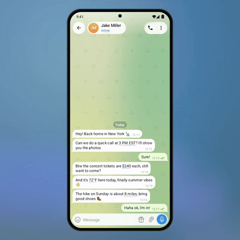

# 🌍 Smart Convert

"Call at 3 PM EST?", "tickets are $240", "72°F here", "about 8 miles" — values like these get a
subtle dotted underline. Tap one and a small card shows it in *your* terms: your time zone with
"in 6 h" and **Add to calendar**, your currency with the rate, metric or imperial units.

<p align="center"></p>

<p align="center"><b>&#9654;&#65039; <a href="demo.mp4">Full-quality video (demo.mp4)</a></b> &middot; Telegram for Android 12.4 design &middot; Android 8+</p>

## How it works

- `SmartUnits.find()` detects times with a zone (EST, PT, CET, MSK…), money (symbols and ISO codes)
  and imperial/metric amounts, skipping what is already in the reader's system.
- Everything runs on the device; nothing is sent anywhere.
- Rates: the prototype has a fixed table; the client would refresh rates once a day from the same
  source it uses for Stars/TON prices.

## Integration into Telegram for Android

| Where | What |
|---|---|
| `MessageObject.addLinks` | add a span per `SmartUnits.Match`, like phone numbers today |
| `ChatMessageCell` | draw the dotted underline for these spans (`LinkPath` with a dash effect) |
| `ChatActivity.didPressUrl` | show the conversion popup (`ActionBarPopupWindow`) above the span |
| Settings | reader's currency and unit system default to the locale |

Files: [`SmartUnits.java`](smart-convert/src/main/java/org/telegram/ui/Components/SmartUnits.java).

## Build and run

Requirements: JDK 17 and the Android SDK (platform 36). Point Gradle at the SDK with
`local.properties` (`sdk.dir=/path/to/Android/sdk`) or `ANDROID_HOME`.

```
./gradlew :smart-convert:assembleDebug
adb install smart-convert/build/outputs/apk/debug/smart-convert-debug.apk
```

The app opens on the demo screen and works by hand. For the presentation look of the video:

```
adb shell am start -n org.telegram.lab.smartconvert/.MainActivity --ez stage true --ez autoplay true
```

## Project layout

| Path | What it is |
|---|---|
| `smart-convert/src/main/java/org/telegram/ui/Components/` | **the feature itself**, drop-in for Telegram's `TMessagesProj` (Android SDK + `AndroidUtilities` only) |
| `smart-convert/src/main/java/org/telegram/lab/smartconvert/` | the demo screen and the scripted demo used for the video |
| `core/` | Telegram 12.4-style UI the demo is built on: chat screen, bubbles, composer, sheets, menus, Telegram's own icons |

## License

GPL-2.0, same as Telegram for Android, whose icons are included in `core`.